# 2ANEND Telemetry

Playtest telemetry for **2ANEND**, a Unity 6 rhythm-battle RPG (my Final Major Project). It's a standalone Unity package: the game feeds it events through one small bridge script, and the package does everything else. It handles consent, session tracking, performance benchmarking, gameplay and movement logging, local JSONL files, a Supabase backend with an offline queue, a live in-game overlay, and a Python report that turns all of it into charts and findings.

This repo holds the telemetry system only, not the game. It opens as a small Unity project with a demo scene, so the system can be run and checked without 2ANEND.

> QA & Telemetry mini-project. The user testing survey is my teammate's half of the project and isn't included in this repo; this repo is the technical data collection half. The two connect through the **session code** (see [Linking to the survey](#linking-to-the-survey)).

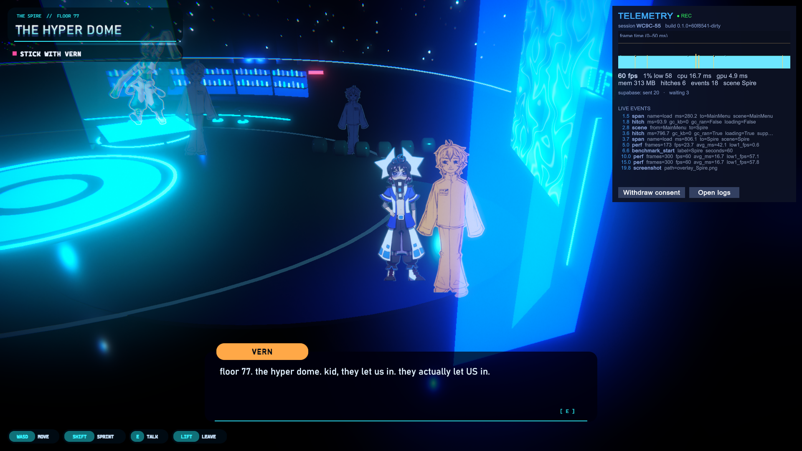

## Contents

| Path | What's there |
|---|---|
| `Packages/com.twoanend.telemetry/` | The Unity package: runtime, editor tools, tests. |
| `Assets/Demo/TelemetryDemo.unity` | Demo scene: a 4-lane rhythm toy that logs exactly what the game does. |
| `Integration/2ANEND/TelemetryBridge.cs` | The bridge from 2ANEND, for reference. It needs the game to compile, so it isn't part of this project. |
| `Tools/analysis/` | `analyse.py`, which builds the HTML report and CSVs, and `make_sample_data.py`. |
| `supabase/schema.sql` | Table, insert-only security rules, and analysis views. |
| `Media/` | GIF and screenshots. |
| `COMMENTARY.md` | The technical commentary. |

## Try it in 2 minutes

1. Open this folder in **Unity 6000.5** (Unity Hub > Add > this folder).
2. Open `Assets/Demo/TelemetryDemo.unity` and press **Play**. If the scene doesn't load, use **Tools > 2ANEND Telemetry > Create Demo Scene**.
3. Use the demo:
   - **D F J K** hit notes;
   - the **arrow keys** walk the dot (tracked for the heatmap);
   - the buttons cause a hitch, a GC spike, a fake load, a story flag, and a battle result.
4. Press **F3** for the live overlay: frame-time graph, FPS and 1% low, CPU and GPU time, memory, upload status, and every event as it's logged.
5. Open **Window > 2ANEND > Telemetry**, then **Open folder** to see the session's `.jsonl`.
6. Build the report:
   ```bash
   cd Tools/analysis
   python -m venv .venv && .venv/Scripts/activate      # macOS / Linux: source .venv/bin/activate
   pip install -r requirements.txt
   python analyse.py "%USERPROFILE%/AppData/LocalLow/DefaultCompany/<ProductName>/Telemetry"
   ```
   Then open `report/index.html`.

In the editor the session counts as consented without asking (`editorAutoConsent`). In a build, the tester gets the consent prompt.

## Evidence

All of these come from the real game: a Windows build of 2ANEND on my PC (i7-12700KF, RTX 4070 Ti, 32 GB, 1080p at 165 Hz). Game screenshots were taken by the game itself (`-telemetryScreenshot`), so nothing else on screen could get into them.

**Consent.** Shown on launch. Nothing is recorded until the tester agrees, and the session code links them to the survey.

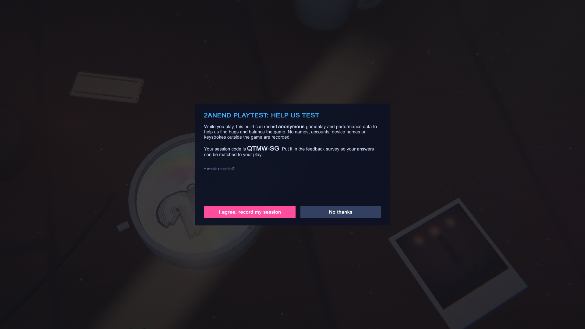

**Live overlay (F3).** Frame-time graph, FPS, 1% low, CPU/GPU time, memory, upload status, and every event as it's logged. Shown here in the Overworld and the Arcade.

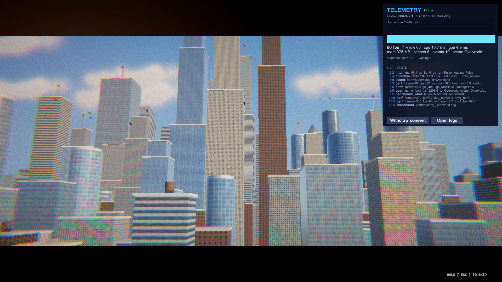
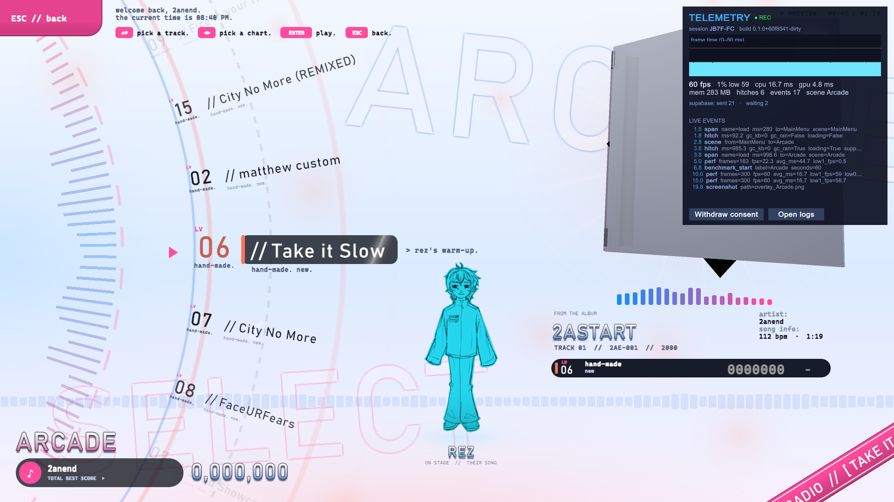

**Log output.** The start of a real session file. Every line is one event: the same JSON that's uploaded.

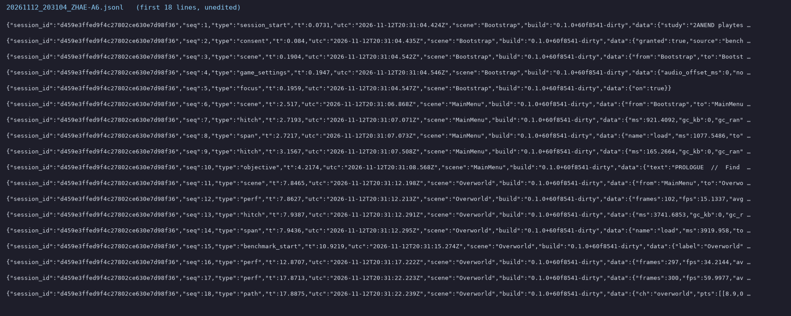

**Supabase.** Every event lands in one table (left). The `telemetry_sessions` view gives one row per session with its code, build, GPU, length and event count (right).

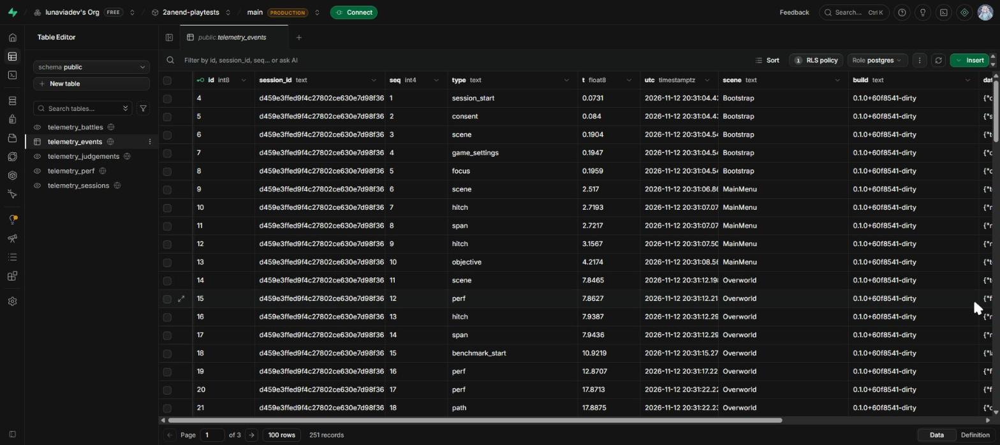
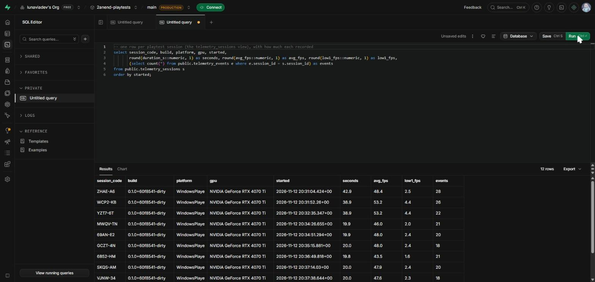

### Benchmark results

Each run used `2ANEND.exe -benchmark -benchmarkScene <scene> -benchmarkSeconds 30`: 30 s of steady play after a 2 s warm-up, with nothing else running. Build `0.1.0+60f8541`.

| Scene | Avg fps | 1% low | 0.1% low | p99 frame | Max frame | CPU (busiest thread) | GPU | Hitches | Memory |
|---|---|---|---|---|---|---|---|---|---|
| Overworld (the city) | 60.0 | 59.2 | 58.3 | 16.7 ms | 17.2 ms | 3.5 ms | 4.4 ms | 0 | 375 MB |
| Spire (the club) | 60.0 | 58.5 | 56.8 | 17.0 ms | 17.7 ms | 1.4 ms | 3.4 ms | 0 | 314 MB |
| Arcade | 60.0 | 58.6 | 56.6 | 16.9 ms | 18.0 ms | 3.4 ms | 4.4 ms | 0 | 283 MB |

**What the data says:**
- **Steady play has plenty of headroom.** No scene uses more than 4.4 ms of its 16.7 ms frame, and there were no hitches while playing.
- **The game is capped at 60 fps** (`targetFrameRate`), even on a 165 Hz display. For a rhythm game, matching the display's refresh rate would make notes smoother and more readable, and the headroom shows it can afford to.
- **Stutter comes from loading.** 28 of 51 hitches across all sessions happened during a load. The Overworld load is the slowest: a median of 2.3 s, up to 3.9 s, about twice as long as any other scene.
- **The main menu stutters** even when it isn't loading, in the benchmark runs and in the playtest alike. That's the next thing to profile.
- Frames from while the game was in the background (alt-tabbed) are left out. Unity pauses the game, so the first frame back would otherwise look like a huge stutter nobody actually played through.

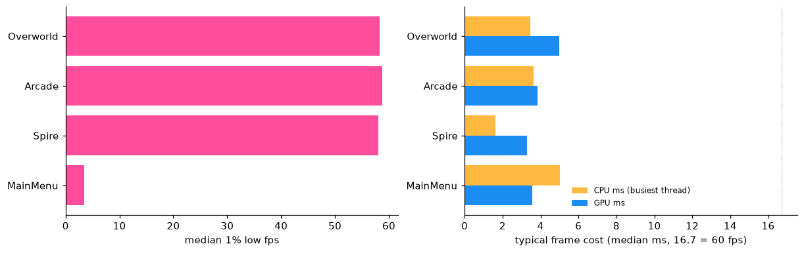
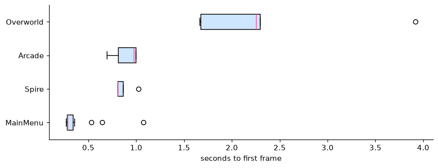
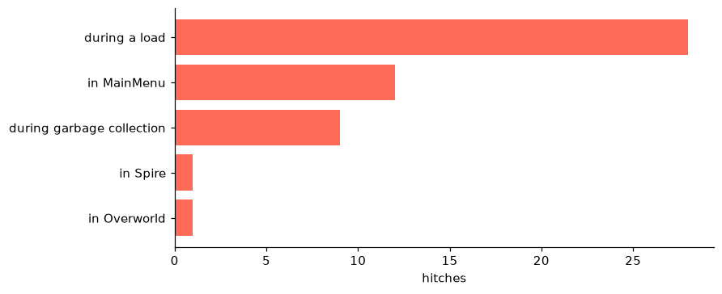

### Playtest: gameplay

**The overlay during a real battle.** The boss remix in the Arcade, with every judged note arriving in the event feed.

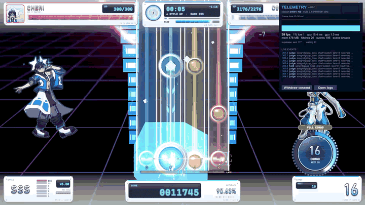

**Playtesting.** Unfortunately no playtesters could be recruited in time to test the game properly, so the only gameplay data is one session I played myself (`BW8V-RB`: 7.3 minutes, 2 battles, 150 judged notes). It shows the whole pipeline working from game to charts, but with one player these results are leads to check with real testers, not conclusions.

- **Timing.** Notes were hit 13 ms early on average (spread 31 ms).
- **Lanes.** Split by lane, the early timing is almost all the left hand: D and F were 21-22 ms early with the most misses, while J and K were nearly on time (−7 and −3 ms). That points to technique or how the left-hand patterns are charted, not to a wrong audio offset, which the overall average alone would have suggested.
- **Chart difficulty.** The boss remix is clean until 22-24 s, where 44% of notes were missed. That's the section to look at in Chart Studio.

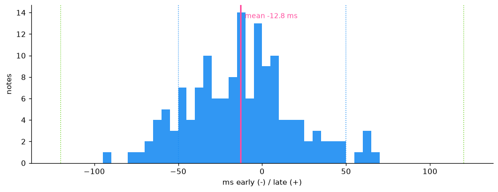
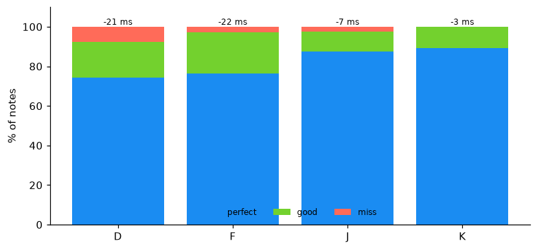
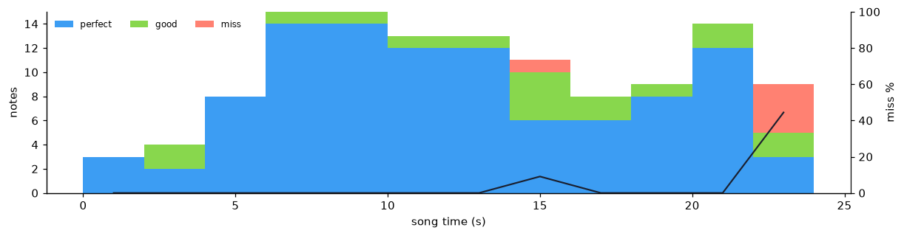

Player heatmaps, story progress and time per objective come from the same pipeline. They need real testers before they say anything, so they're left out here.

## What it records

Every event is one JSON line:

```json
{"session_id":"3f2a…","seq":412,"type":"judge","t":184.233,"utc":"2026-11-10T14:03:11.402Z","scene":"Overworld","build":"0.1.0+3fa9c21",
 "data":{"song":"riff_wildfire","chart":"hard","lane":2,"note":"tap","result":"good","ms":-63.1,"song_t":47.82,"combo_before":31,"hp":72}}
```

The top-level keys are the Supabase table's columns, so the same line is written to the file and uploaded.

| Event | When | Key fields |
|---|---|---|
| `session_start` | Launch | build and git commit, platform, OS, CPU and cores, RAM, GPU and VRAM, graphics API, resolution, refresh rate, quality, vsync, anonymous `player_id`, `session_code` |
| `consent` | The tester answers | granted, source (prompt / survey / editor / benchmark) |
| `perf` | Every 5 s | fps, 1% and 0.1% low, p50 / p95 / p99 / max frame ms, CPU (main and render thread) and GPU ms, CPU- or GPU-bound, memory (allocated, reserved, mono, system), GC collections, GC KB per frame, draw calls, batches, SetPass calls, triangles |
| `hitch` | Any frame over 50 ms | ms, GC allocation that frame, whether GC ran, whether a load was happening, the song and song time if in a battle |
| `span` (`load`) | Scene change to first frame | ms, the scene it went to |
| `scene` | Active scene changes | from, to |
| `battle_start` / `battle_end` | Each battle | song, chart, attempt number, opponent; then outcome, score, accuracy, grade, perfect / good / miss, max combo, length, HP, song time when it ended |
| `judge` | Every note | lane, note type, result, **timing error in ms** (early − / late +), song time, combo, HP |
| `hold` | A hold is released | result, release timing |
| `battle_pause` / `resume` / `forfeit` / `loop` / `restart` | In a battle | song time |
| `path` | Every 10 position samples (1 per second) | channel (`overworld`, `club`), points `[t, x, y, z]` |
| `talk_start` / `talk_end` | Dialogue | NPC, seconds |
| `objective` | Objective changes | text, how long the previous one took |
| `flag` | Story progress | flag name |
| `game_settings` / `options` | Launch / options change | audio offset, note speed, difficulty, volumes |
| `benchmark` | `-benchmark` run | the full perf summary plus machine info |
| `session_end` | Quit | duration, session-wide perf summary, hitches, peak memory, event counts |

Anything a platform can't measure, such as GPU time where it isn't reported, is left out of the event. It is never logged as a fake zero.

## Using it in a game

**Install:** in the game's `Packages/manifest.json`:

```json
"com.twoanend.telemetry": "https://github.com/lunaviadev/2anend-telemetry.git?path=Packages/com.twoanend.telemetry"
```

**Config:** use Tools > 2ANEND Telemetry > Create Config. That writes `Assets/Resources/telemetry_config.json`, and `telemetry_config.example.json` documents every field. **Keep this file out of git**: it holds the Supabase key.

**Log things.** Telemetry starts itself on boot. There's nothing to add to a scene.

```csharp
using TwoAnEnd.Playtest;

Telemetry.Log("judge", "lane", 2, "result", "good", "ms", -18.4f);   // type + key/value pairs
Telemetry.BeginSpan("load", "to", "Overworld");  /* ... */  Telemetry.EndSpan("load");
Telemetry.Track("overworld", player.transform);                    // position heatmap
Telemetry.AddContext("song", () => currentSong);                   // attached to hitches
Telemetry.SetConsent(true, "survey");                              // from your own consent UI
```

**The bridge pattern:** the package never references the game. 2ANEND has one script, [`TelemetryBridge.cs`](Integration/2ANEND/TelemetryBridge.cs), that subscribes to static events the game raises, such as `JudgementSystem.AnyJudged`, `CombatController.AnyBegan` / `AnyEnded`, `GameSceneManager.SceneLoading` and `Settings.FlagChanged`, and turns them into log calls. Taking telemetry out of the game means deleting one file.

## Consent and privacy

- **Nothing is written before consent.** Before the tester answers, events wait in memory so the session's start isn't lost. If they decline, those events are dropped. If they agree, the events are written in order.
- Consent comes from the built-in prompt or from the game's own UI (`askConsent: false`, then call `Telemetry.SetConsent`). Ask every launch for shared playtest PCs (`askEverySession`), or remember the answer.
- **Withdrawing** from the F3 overlay deletes this PC's telemetry files and stops uploads. A tester can ask for their uploaded data to be deleted by giving their session code (there's a query in `schema.sql`).
- **No personal data:** no names, accounts, device names, hardware serials, or input outside the game. The player id is a random number in PlayerPrefs.
- The build uploads with Supabase's public anon / publishable key. Row level security lets that key **insert only**, so someone who pulls the key out of a build can't read anyone's data. Analysis uses the service_role key, which never goes in a build.

## Storage

- **Local:** `Application.persistentDataPath/Telemetry/`
  - `yyyyMMdd_HHmmss_<code>.jsonl` per session, plus a `.summary.json` when the session ends.
  - The file is flushed every second, so a crash loses at most a second, and every earlier line still parses.
- **Supabase (optional)**, to compare sessions from many testers in one place:
  1. Create a project at supabase.com, open the SQL Editor, and run `supabase/schema.sql`.
  2. Under Project Settings > API, copy the URL and the anon (or publishable) key into `telemetry_config.json` as `supabaseUrl` and `supabaseAnonKey`.
  3. Uploads go out every 10 s, 250 events at a time.
- **Offline-first:** every event goes into `outbox.jsonl` and only leaves it after a 2xx response. With no internet, a crash, or a closed laptop, the events wait and upload on the next run. Retries back off from 5 s to 5 min. Batches are sent with `on_conflict=session_id,seq`, so a retry can't create duplicates.
- Editor sessions stay local unless `uploadFromEditor` is on.

## Performance metrics

- **1% low / 0.1% low:** 1000 ÷ the mean time of the slowest 1% (0.1%) of frames. Averages hide stutter, and the lows don't.
- **CPU vs GPU:** comes from `FrameTimingManager`, which needs Player Settings > Other > **Frame Timing Stats**. It shows which side is limiting the frame rate, so you know what to optimise.
- **Draw calls, batches, SetPass, triangles:** from `ProfilerRecorder`. These are only available in the editor and development builds.
- **Hitches** carry what was happening when they hit (GC, loading, the song and song time), so they can be traced back to a cause.

**Benchmark mode:** repeatable, like-for-like comparisons between builds.

```bash
2ANEND.exe -benchmark -benchmarkScene Overworld -benchmarkSeconds 30
```

It goes to the scene, lets it settle, records for 30 s after a 2 s warm-up, writes `benchmark_<build>_<scene>_<time>.json`, and quits.

## The report

`python Tools/analysis/analyse.py [folders or files] [--supabase] [--no-editor] [--build X]` writes `report/index.html` and CSVs (`events`, `judgements`, `perf`, `battles`):

- **Findings:** plain-language conclusions, such as the roughest scene, CPU vs GPU, what causes hitches, the slowest load, the timing offset to fix, the weakest lane, the hardest stretch of each chart, where the story loses players, and the objective people get stuck on.
- **Performance:** FPS and 1% low over each session with hitches and scene changes marked, by build, by scene with CPU / GPU, memory, hitch causes, load times.
- **Rhythm:**
  - a hit-timing histogram against the judgement windows;
  - each player's offset;
  - accuracy by lane;
  - a **miss map** per chart (misses across song time, which shows which bars to fix in the chart editor);
  - battle win rates and attempts.
- **World:** a position heatmap, the story progress funnel, time per objective, conversation lengths.

`--supabase` pulls everything first. Set `SUPABASE_URL` and `SUPABASE_SERVICE_KEY`.

`make_sample_data.py` writes synthetic sessions for trying the report before any playtests. Reports built from them carry a **SAMPLE DATA** banner, so they're never mistaken for evidence.

## Linking to the survey

Each session has a short code, such as `7F3K-Q2`. It's shown on the consent prompt and in the corner watermark while recording, and it's written into the session header. The survey asks for it ("Your session code, bottom-left of the game screen"). The report's Sessions table lists the codes, so each tester's answers (their difficulty ratings, the bugs they reported) can be matched to what actually happened in their session: their FPS, the notes they missed, where they got stuck. If the survey is built into the game instead, it can call `Telemetry.Log("survey", ...)` and the answers land in the same session log.

## Tests

Window > General > Test Runner > EditMode runs the tests. They cover:
- the JSON writer: escaping, numbers that ignore the PC's locale, NaN;
- the perf statistics: lows and percentiles;
- the session codes.

## AI disclosure

I used Claude Code (Anthropic's AI coding assistant) in order to better help with debugging code and fixing potential errors that had cropped up during development, thus requiring a bit of help due to my lack of knowledge and expertise in this field but wanting a properly optimised tool that would actually be usuable in the final build.

All the data, screenshots and results shown are real and come from the game.
